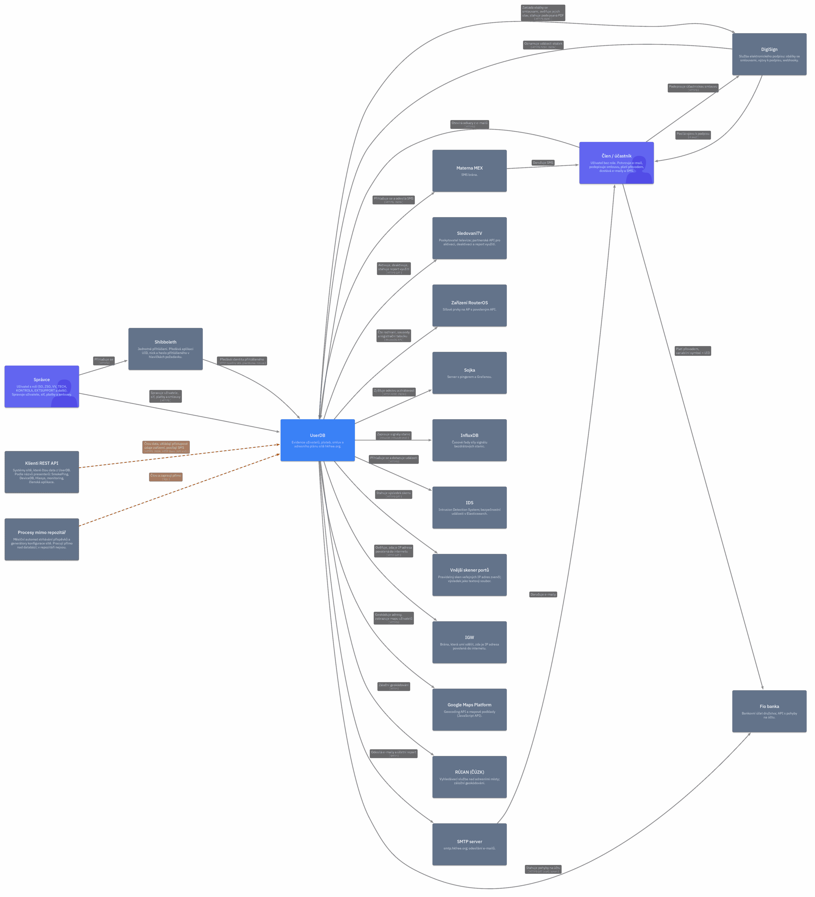
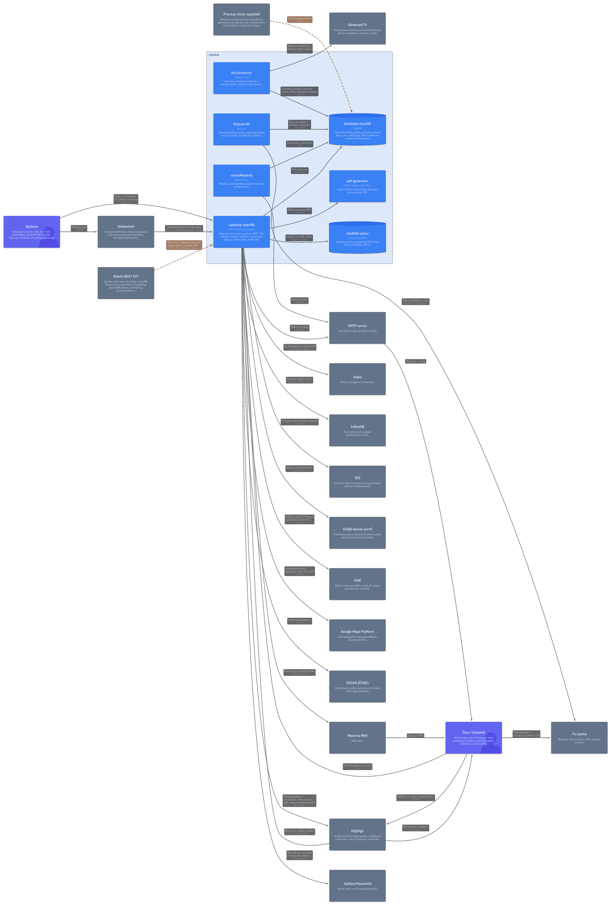
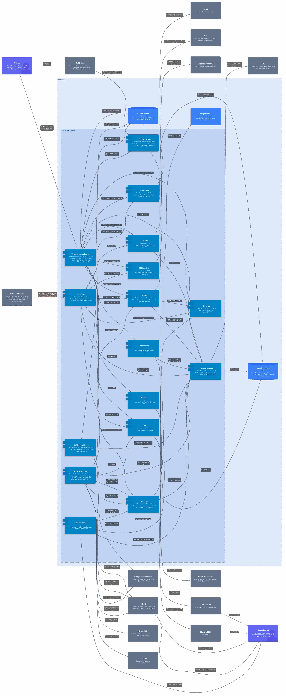
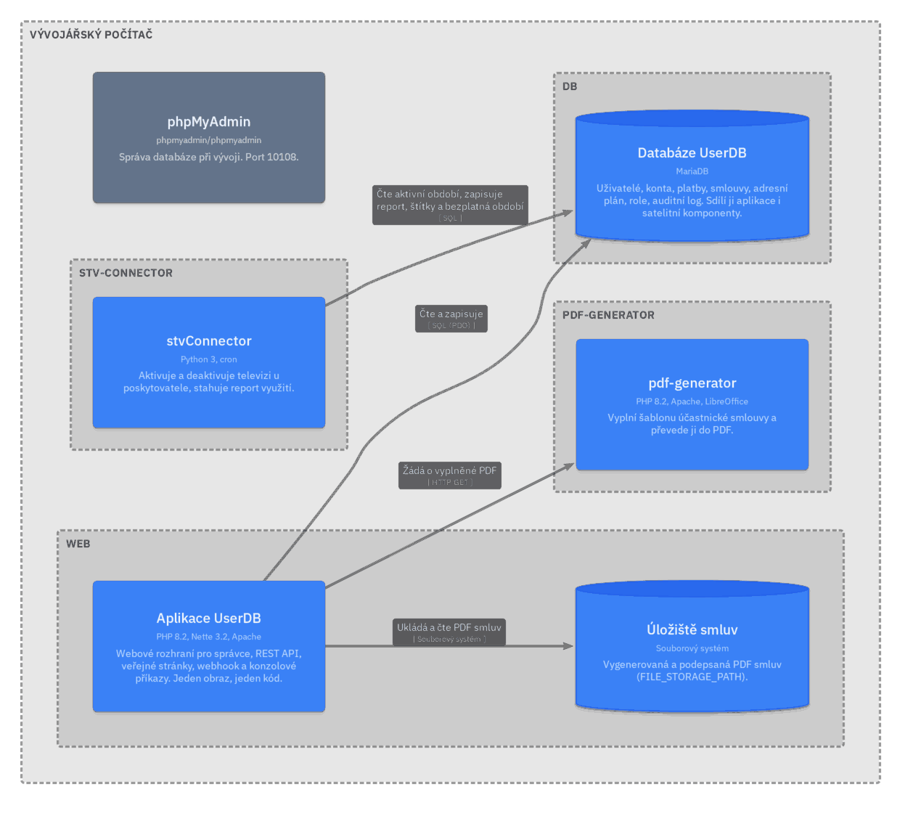
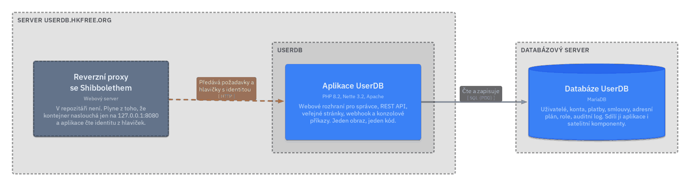

# UserDB – architektura (model C4)

Architektura systému UserDB v modelu C4, odvozená z kódu ve stavu commitu `f7f37e5` (`origin/master`). Funkční popis je ve [specifikaci systému](specifikace-systemu.md).

Model je zapsaný v [LikeC4](https://likec4.dev) ve složce [`c4/`](c4/):

| Soubor | Obsah |
|---|---|
| [`c4/specification.c4`](c4/specification.c4) | druhy prvků, vazeb a uzlů nasazení |
| [`c4/model.c4`](c4/model.c4) | prvky, vazby a nasazení |
| [`c4/views.c4`](c4/views.c4) | pohledy (diagramy) |
| [`c4/diagramy/`](c4/diagramy/) | obrázky vygenerované z pohledů |

Obrázky na této stránce jsou vygenerované z modelu; ručně se neupravují (kapitola 5). Jsou velké, proto je vhodné si je otevřít samostatně a přiblížit. Model lze také procházet interaktivně: `npx likec4@1.61.0 start specs/c4`.

Jak diagramy číst:

- modré prvky jsou součástí UserDB, šedé jsou okolní systémy, fialové jsou lidé,
- přerušovaný okraj prvku a oranžová přerušovaná šipka značí prvek nebo vazbu, které z kódu plynou jen nepřímo,
- popisek šipky uvádí účel a v hranatých závorkách protokol.

## 1. Kontext (úroveň 1)

Kdo se systémem pracuje a se kterými systémy si vyměňuje data.



| Prvek | Role vůči UserDB |
|---|---|
| Správce | Jediný, kdo se do UserDB přihlašuje. Každý správce je zároveň uživatelem v evidenci. |
| Člen / účastník | Do UserDB nevstupuje. Dotýká se ho přes e-maily, SMS, veřejné potvrzovací odkazy, podpis smlouvy a platby. |
| Shibboleth | Přihlášení správců. UserDB mu plně důvěřuje: identitu čte z hlaviček požadavku. |
| DigiSign | Obousměrná vazba: UserDB zakládá obálky, DigiSign zpět hlásí jejich stav webhookem. |
| Fio banka, SledovaniTV | Volají je satelitní komponenty, ne hlavní aplikace. |
| Klienti REST API | Konkrétní systémy z kódu určit nelze; výčet vychází z názvů presenterů a ze `swagger.yaml`. |
| Procesy mimo repozitář | Kód počítá s daty, která sám nevytváří (měsíční strhávání příspěvků) a eviduje příznaky, které sám nečte (export do DHCP, DNS). Z toho plyne existence dalších procesů nad stejnou databází. |

Protokoly, přihlašování a konfigurace jednotlivých vazeb jsou v kapitole 8 specifikace.

## 2. Kontejnery (úroveň 2)

Samostatně běžící části systému.



| Kontejner | Technologie | Odpovědnost | Zdroj |
|---|---|---|---|
| Aplikace UserDB | PHP 8.2, Nette 3.2, Apache | Webové rozhraní, REST API, veřejné stránky, webhook, konzolové příkazy | `app/`, `www/`, `bin/console` |
| Databáze UserDB | MariaDB | Veškerá trvalá data; schéma spravují migrace | `db/` |
| Úložiště smluv | souborový systém | Vygenerovaná a podepsaná PDF smluv | cesta z `FILE_STORAGE_PATH` |
| pdf-generator | PHP 8.2, Apache, LibreOffice | Vyplnění šablony smlouvy a převod do PDF | `pdfGenerator/` |
| fio2userdb | Perl, cron | Import pohybů z banky a jejich připsání na konta | `fio2userdb/` |
| stvConnector | Python 3, cron | Aktivace a deaktivace televize, report využití | `stvConnector/` |
| ucetniReporty | Python 3, cron | Měsíční účetní report e-mailem | `ucetniReporty/` |

Dvě vlastnosti architektury stojí za zdůraznění:

- **Integrace přes databázi.** Satelitní komponenty nevolají API aplikace; čtou a zapisují přímo do jejích tabulek. Databázové schéma je tak sdílené rozhraní a jeho změna se týká všech komponent.
- **Jeden kód, více vstupů.** Webové rozhraní, API, webhook i konzolové příkazy jsou jedna aplikace nad jedním DI kontejnerem. Liší se jen vstupním bodem (`www/index.php`, `www/digisign-webhook/index.php`, `bin/console`).

## 3. Komponenty aplikace (úroveň 3)

Vnitřní členění kontejneru „Aplikace UserDB“. Nejde o moduly vynucené strukturou kódu, ale o logické celky podle odpovědnosti.



| Komponenta | Kde v kódu | Odpovědnost |
|---|---|---|
| Webové rozhraní správců | `app/presenters/`, `app/templates/`, `app/components/` | Obrazovky a formuláře pro správce |
| Veřejné stránky | `app/presenters/SelfServicePresenter.php` | Stránky dostupné bez přihlášení z odkazů v e-mailech |
| REST API | `app/ApiModule/` | Operace pro další systémy, přihlášení API klíčem |
| DigiSign webhook | `www/digisign-webhook/` | Příjem událostí obálek mimo Nette router |
| Konzolové příkazy | `app/Console/`, `bin/console` | Migrace a dávkové úlohy |
| Přihlášení a role | `app/model/Authenticator.php`, `HkfIdentity.php`, `AP.php`, `app/presenters/BasePresenter.php` | Identita z hlaviček, role, pomocné funkce pro přístup k AP |
| Datové modely | `app/model/` | Třídy tabulek a doménová pravidla |
| Auditní log | `app/model/Log.php`, `app/components/LogTable.php` | Zápis a zobrazení historie změn |
| Smlouvy | `app/services/RequestDruzstvoContract.php`, `GeneratorSmlouvy.php`, `SmlouvaStavSluzba.php` | Založení smlouvy, PDF, stav |
| E-maily | `app/services/MailService.php` | Sestavení a odeslání e-mailů |
| SMS | `app/model/Komunikace.php`, `app/services/MexSmsSender.php` | Odeslání SMS |
| Šifrování | `app/services/CryptoSluzba.php` | Symetrické šifrování citlivých hodnot |
| Wewimo | `app/model/Wewimo.php` | Čtení bezdrátových klientů ze zařízení |
| Stav sítě | `app/model/Status.php`, `Sojka.php` | Vyhodnocení dostupnosti AP |
| IDS konektor | `app/model/IdsConnector.php` | Dotazy na bezpečnostní události |
| Vnější sken | `app/model/VnejsiScanner.php` | Zpracování výsledků skenu portů |

Smlouva vzniká ve dvou krocích, proto mezi komponentami „Smlouvy“ a „Konzolové příkazy“ vede vazba oběma směry: webový požadavek založí řádek smlouvy a spustí konzolový příkaz na pozadí; ten si zpět vyžádá parametry a PDF smlouvy a komunikuje s DigiSign.

## 4. Nasazení

### 4.1 Vývojové prostředí

Podle `docker-compose.yml`. Komponenty `fio2userdb` a `ucetniReporty` v něm nejsou.



| Služba | Obraz | Port na hostiteli |
|---|---|---|
| `web` | sestavený z `Dockerfile` (`php:8.2-apache-bookworm`) | 10107 |
| `db` | `mariadb:10.1` | 10306 |
| `pdf-generator` | sestavený z `pdfGenerator/Dockerfile` | 10109 |
| `stv-connector` | sestavený z `stvConnector/Dockerfile` | – |
| `phpmyadmin` | `phpmyadmin/phpmyadmin` | 10108 |

### 4.2 Produkce

Podle `git-hooks/post-receive.sample` a README. Diagram zachycuje jen to, co je v repozitáři doloženo.



Co z repozitáře zjistit nelze:

- konfiguraci webového serveru před kontejnerem (HTTPS, Shibboleth, výjimka pro veřejné stránky, API a webhook),
- kde a jak v produkci běží `pdf-generator`, `fio2userdb`, `stvConnector` a `ucetniReporty`,
- plánování pravidelných konzolových úloh,
- umístění a zálohování úložiště smluv.

## 5. Údržba modelu

Model se mění jen v souborech `c4/*.c4`. Po úpravě je třeba model zvalidovat a znovu vygenerovat obrázky:

```bash
# interaktivní prohlížení modelu při úpravách
npx likec4@1.61.0 start specs/c4

# validace
npx likec4@1.61.0 validate specs/c4
```

Export obrázků používá prohlížeč Chromium přes Playwright ve verzi, kterou si LikeC4 přináší. Nejspolehlivější je proto nainstalovat LikeC4 do dočasného adresáře a prohlížeč stáhnout jeho vlastním Playwrightem:

```bash
npm install --prefix /tmp/likec4 likec4@1.61.0
/tmp/likec4/node_modules/.bin/playwright install chromium

# export pohledů do PNG
/tmp/likec4/node_modules/.bin/likec4 export png --flat -o specs/c4/diagramy specs/c4

# zmenšení pro repozitář (ImageMagick): bílé pozadí, poloviční rozlišení, paleta 64 barev
mogrify -background white -flatten -resize 50% -dither None -colors 64 -strip specs/c4/diagramy/*.png
```

Konvence v modelu:

- tag `#usudek` označuje prvky a druh vazby `usudek` vazby, které nejsou v kódu doloženy přímo,
- vazby se zapisují na nejnižší úrovni (komponenta → cíl); vazby na vyšších úrovních si LikeC4 odvodí,
- kde jednu šipku v pohledu tvoří více vazeb, LikeC4 ji popíše jen jako `[...]`; takové šipky mají v `views.c4` výslovně zadaný souhrnný popisek,
- pohled `index` je kontextový diagram a zároveň úvodní stránka interaktivního prohlížeče.
